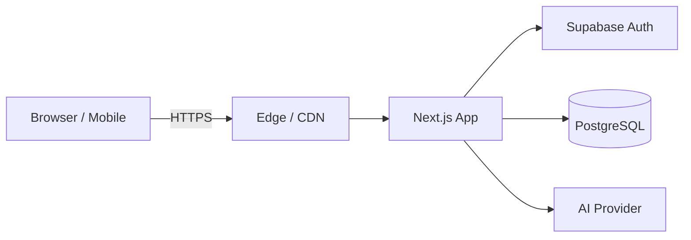

# aion — case study draft

> Status: **draft**. Replace every `TODO(...)` with a verified fact, or
> delete the line. Do not invent numbers, dates, or claims.

## Identity

- **Title:** aion
- **Slug:** aion
- **Category:** AI / PLATFORM
- **Featured:** TODO(set true or false)
- **Published:** true
- **Technologies (suggested seed list, edit to match what aion actually uses):**
  TODO(confirm with the owner which of these are in the repo, remove the rest)
  e.g. Next.js, React, TypeScript, Tailwind CSS, Node.js, PostgreSQL,
       Supabase, OpenAI, Vercel

## Summary (one-liner shown on the home grid)

TODO(one sentence: what aion is and who it is for, in plain English.
Avoid metrics here — keep it under 160 characters.)

## Description (the long-form intro rendered above the tabs)

aion is a TODO(what it is in one paragraph, no marketing fluff, no
numbers you can't prove). It targets TODO(audience) and runs as a
TODO(web app / mobile app / desktop app / API).

## Architecture

TODO(replace the diagram with the real one once the owner confirms the
exact pieces. The render block above is only a placeholder so the
MarkdownRenderer can be exercised.)

## Key features

- TODO(feature 1)
- TODO(feature 2)
- TODO(feature 3)

## Challenges

- TODO(the hardest technical problem in the build, in one sentence, plus
  the workaround).

## Lessons learned

- TODO(one concrete engineering lesson — what the owner would tell a
  junior building something similar).

## Future plans

- TODO(one next step the owner is confident they will ship).

## Role / team / duration / status / metrics (admin form fields)

- **Role:** TODO(e.g. Lead Full-stack Developer)
- **Team size:** TODO(number, plus 1 if solo)
- **Duration:** TODO(e.g. Mar 2024 — present)
- **Status:** TODO(e.g. live, in private beta, paused)
- **Metrics:** TODO(only verified numbers, otherwise leave blank)
- **GitHub:** TODO(real public URL or blank)
- **Live:** TODO(real deployed URL or blank)
